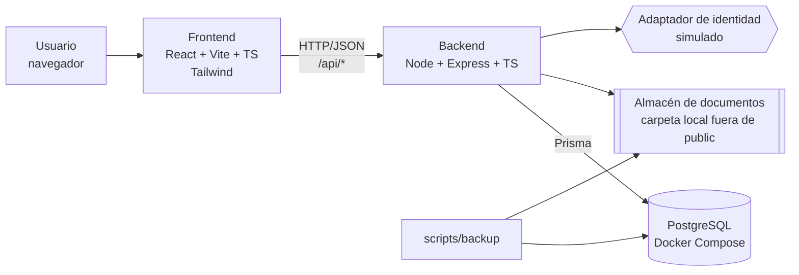
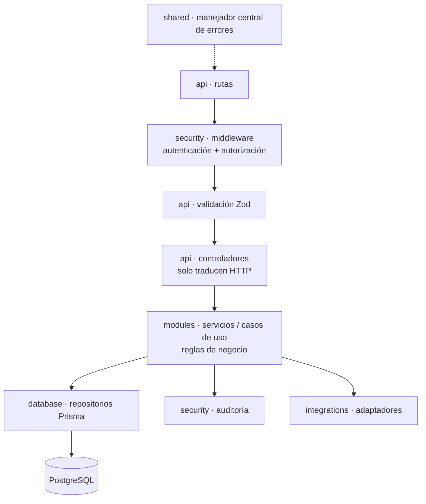
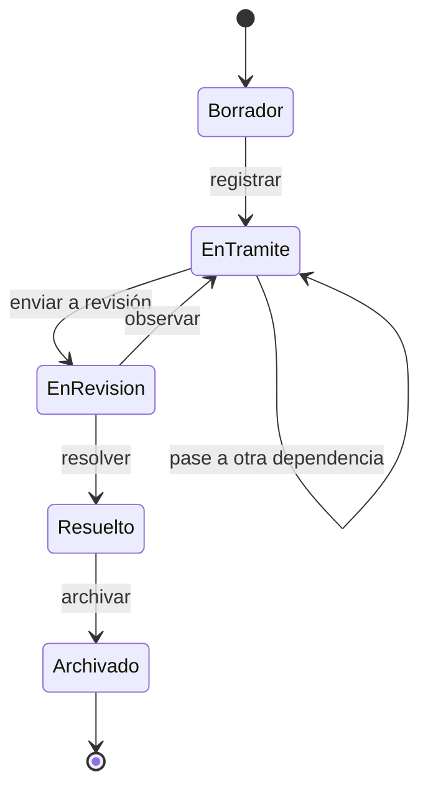

# Arquitectura

**Estado:** Inicial (Fase 0) · **Unidad:** 8 · **Tarjeta:** F0-04

## 1. Vista general

Aplicación web de tres niveles que se ejecuta en una sola computadora:



## 2. Capas del backend

Cada petición recorre las capas en un solo sentido. Las reglas de negocio **no** van en los controladores.



| Capa | Carpeta | Responsabilidad | No debe |
|---|---|---|---|
| Presentación | `frontend/src` | Páginas, componentes, formularios, navegación, llamadas a la API. | Decidir permisos (solo oculta botones; el servidor decide). |
| API | `backend/src/api` | Rutas, controladores, validación de entrada y formato de respuesta. | Contener reglas de negocio ni consultas SQL. |
| Negocio | `backend/src/modules` | Servicios y casos de uso: numeración, máquina de estados, pases, vencimientos. | Conocer Express (`req`, `res`). |
| Persistencia | `backend/src/database`, `backend/prisma` | Esquema, migraciones, acceso a datos. | Aplicar reglas de negocio. |
| Seguridad | `backend/src/security` | Hash de contraseñas, sesión/token, verificación de permisos, auditoría. | — |
| Integraciones | `backend/src/integrations` | Interfaces y adaptadores para servicios externos simulados (identidad, almacenamiento). | Ser llamadas directamente desde controladores. |
| Transversal | `backend/src/shared`, `backend/src/config` | Errores tipados, logger, configuración desde variables de entorno. | — |

## 3. Módulos de negocio previstos

| Módulo | Sprint | Contenido |
|---|---|---|
| `auth` | 2 | Inicio/cierre de sesión, adaptador de identidad. |
| `usuarios` | 2 | Usuarios, roles, dependencias. |
| `expedientes` | 3 | Alta, consulta, modificación, numeración, búsqueda. |
| `documentos` | 4 | Carga, almacenamiento, descarga controlada. |
| `actuaciones` | 4 | Actuaciones, observaciones, historial. |
| `seguimiento` | 5 | Responsables, tareas, estados, pases, notificaciones. |
| `reportes` | 6 | Estadísticas, reportes, exportación. |
| `auditoria` | 2 y 7 | Registro y consulta de auditoría. |
| `respaldo` | 7 | Copia de seguridad y restauración. |

## 4. Contrato entre frontend y backend

- Prefijo `/api`, recursos en plural y en español (`/api/expedientes`).
- Respuesta exitosa: `{ "data": ..., "meta": { "page", "pageSize", "total" } }` (meta solo en listados).
- Respuesta de error: `{ "error": { "code": "EXPEDIENTE_NO_ENCONTRADO", "message": "texto para el usuario", "details": [...] } }`. Nunca incluye trazas ni SQL.
- Códigos HTTP: 200/201 éxito · 400 validación · 401 sin sesión · 403 sin permiso · 404 no existe · 409 conflicto (transición de estado no válida, duplicado) · 500 error interno genérico.
- Los esquemas Zod se comparten para validar en ambos lados (S3-06).

## 5. Máquina de estados del expediente (propuesta)



Cualquier otra transición devuelve **409**. Se confirma con el Product Owner en el Sprint 5 (S5-03).

## 6. Seguridad en la arquitectura

- Autenticación con sesión o JWT de corta duración en cookie `httpOnly` (decisión final en el Sprint 2, ver ADR-05).
- Autorización por permisos asociados a roles, verificada en middleware y, cuando depende del dato (por ejemplo, la dependencia), en el servicio.
- Auditoría en tabla de solo inserción; el usuario de aplicación no tiene permisos de `UPDATE`/`DELETE` sobre ella.
- Documentos en `storage/` (ignorado por Git), nombre interno aleatorio y hash SHA-256.

## 7. Estructura de carpetas

```
is3/
├── backend/   src/{config, api, modules, shared, security, integrations, database} · prisma/ · tests/{unit, integration}
├── frontend/  src/{components, pages, layouts, routes, services, hooks, styles} · public/ · tests/
├── infra/docker/          docker-compose de PostgreSQL
├── scripts/backup/        respaldo y restauración
├── .github/workflows/     integración continua
└── docs/                  documentación (este directorio)
```
