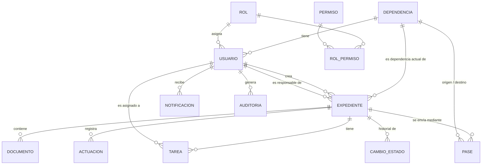

# Modelo de datos

**Estado:** Parcialmente implementado (Sprint 2): dependencias, roles, permisos, usuarios, sesiones y auditoría en `backend/prisma/schema.prisma`. El resto de las entidades se implementa en los Sprints 3 a 5. · **Unidad:** 3

## 1. Diagrama entidad-relación

## 2. Entidades

| Entidad | Campos principales | Restricciones |
|---|---|---|
| **Dependencia** | id, codigo, nombre, activa | `codigo` único |
| **Rol** | id, clave, nombre, descripcion | `clave` única (p. ej. `ADMINISTRADOR`) |
| **Permiso** | id, clave (p. ej. `expediente.crear`), descripcion | `clave` única |
| **RolPermiso** | rolId, permisoId | PK compuesta |
| **Usuario** | id, username, email, nombre, passwordHash, rolId, dependenciaId, activo, ultimoAcceso, creadoEn | `username` y `email` únicos; FK a Rol y Dependencia; baja lógica con `activo` |
| **Expediente** | id, numero, caratula, asunto, tipo, iniciador, estado, prioridad, dependenciaActualId, responsableId, creadoPorId, fechaVencimiento, creadoEn, actualizadoEn | `numero` único con formato `EXP-AAAA-NNNNNN`; `estado` enum |
| **Documento** | id, expedienteId, nombreOriginal, nombreAlmacenado, tipoMime, tamanoBytes, hashSha256, subidoPorId, subidoEn | FK a Expediente; `tamanoBytes` ≤ límite; tipo en lista permitida |
| **Actuacion** | id, expedienteId, tipo (actuación / observación), texto, autorId, fecha | FK; no se edita, se agrega otra |
| **Tarea** | id, expedienteId, titulo, descripcion, asignadoAId, vencimiento, estado, completadaEn | FK; `vencimiento` obligatorio |
| **Pase** | id, expedienteId, origenId, destinoId, enviadoPorId, enviadoEn, recibidoPorId, recibidoEn, motivo | FK; `origenId ≠ destinoId` |
| **CambioEstado** | id, expedienteId, estadoAnterior, estadoNuevo, usuarioId, fecha, motivo | FK; solo inserción |
| **Notificacion** | id, usuarioId, tipo, mensaje, expedienteId, leida, creadaEn | FK |
| **Sesion** *(Sprint 2)* | id (hash SHA-256 del token), usuarioId, creadaEn, expiraEn, ip, userAgent | FK a Usuario con borrado en cascada; índice por vencimiento (ADR-05) |
| **Auditoria** | id, fecha, usuarioId, accion, resultado (`EXITO`/`FALLO`), entidad, entidadId, detalle (JSON), ip, requestId | Solo inserción (ADR-07); `usuarioId` opcional (login fallido de un correo inexistente) |
| **Secuencia** | anio, ultimoNumero | Genera el número de expediente de forma atómica por año |

## 3. Enumeraciones

- **EstadoExpediente:** `BORRADOR`, `EN_TRAMITE`, `EN_REVISION`, `RESUELTO`, `ARCHIVADO`.
- **EstadoTarea:** `PENDIENTE`, `EN_CURSO`, `COMPLETADA`, `CANCELADA`.
- **Prioridad:** `BAJA`, `MEDIA`, `ALTA`.

## 4. Reglas de integridad

1. Un expediente siempre tiene una dependencia actual; cambia solo cuando se **recibe** un pase.
2. El historial del expediente se arma con `Actuacion`, `Documento`, `Pase` y `CambioEstado`, ordenados por fecha; ninguno de ellos se borra físicamente.
3. Las claves foráneas usan `ON DELETE RESTRICT`: no se puede eliminar una dependencia o usuario con expedientes asociados.
4. El número de expediente se genera dentro de una transacción para evitar duplicados.
5. Índices previstos: `Expediente(estado)`, `Expediente(dependenciaActualId)`, `Expediente(fechaVencimiento)`, `Auditoria(fecha)`, búsqueda de texto sobre `caratula` y `asunto`.

## 5. Datos de prueba

Solo datos ficticios: dependencias como "Mesa de Entradas", "Asesoría Jurídica", "Recursos Humanos"; usuarios con correos del dominio `@institucion.test`. Se cargan con un *seed* (S2-06, S8-02).

## 6. Convenciones de implementación (Sprint 2)

- Tablas en plural y `snake_case` (`usuarios`, `roles_permisos`, `auditoria`) mediante `@@map`/`@map`; en el código se usan los nombres del modelo (`Usuario`, `rolId`).
- El correo se guarda en minúsculas; la búsqueda de usuarios no distingue mayúsculas.
- Baja lógica de usuarios con `activo = false`: un usuario nunca se borra porque la auditoría lo referencia (`ON DELETE RESTRICT`).
