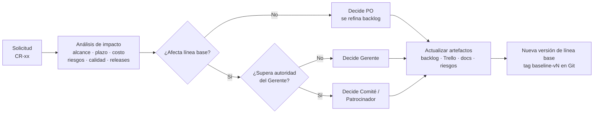

# Control integrado de cambios

**Estado:** Vivo · **Unidades:** 2, 3 y 8 · **Tarjetas:** CF-02, CF-03

## 1. Qué pasa por control de cambios

| Pasa por control formal (predictivo) | Se gestiona dentro del sprint (adaptativo) |
|---|---|
| Cambios de alcance que agregan o quitan requisitos `RF`/`RNF` | Reordenar prioridades del backlog |
| Cambios en fechas de hitos o en la cantidad de sprints/releases | Dividir historias o ajustar sus criterios sin cambiar el requisito |
| Cambios en requisitos normativos o de seguridad | Corregir defectos |
| Cambios en la arquitectura aceptada (ADR) | Refactorizaciones internas |
| Cualquier cambio a un documento en estado *Línea base* | Mejoras de UX dentro de una historia |

## 2. Procedimiento



1. Cualquier integrante registra la solicitud en este documento y crea una tarjeta en la lista *Control formal* de Trello.
2. El Gerente analiza el impacto con la plantilla de la sección 3.
3. Decide quien corresponde según el escalamiento de [enfoque-gobernanza.md](enfoque-gobernanza.md#escalamiento).
4. Si se aprueba: se actualizan backlog, Trello, requisitos, riesgos y cronograma; se registra en el [historial de cambios](historial-cambios.md); si cambia la línea base, se etiqueta una nueva versión (`baseline-v2`, …).
5. Si se rechaza: queda registrada con el motivo.

## 3. Plantilla de solicitud

```
CR-xx · Título
Fecha / Solicitante:
Descripción del cambio:
Motivo (origen: normativa, usuario, riesgo, técnico):
Impacto en alcance (RF/RNF, historias):
Impacto en plazo y SP:
Impacto en riesgos:
Impacto en calidad / pruebas:
Releases y despliegue afectados:
Decisión / Quién decide / Fecha:
Artefactos actualizados:
```

## 4. Registro de cambios

| ID | Título | Fecha | Estado | Decide |
|---|---|---|---|---|
| CR-00 | Unificación del backlog del TP con el alcance del prototipo | 13/10/2026 | **Aprobado** 14/10/2026 | Gerente / Comité |
| CR-01 | Evento de cambio: nuevo control documental + retraso del proveedor de identidad | — | Planificado para el piloto (R3) | Comité |

### CR-00 · Unificación del backlog del TP con el alcance del prototipo

- **Solicitante:** Gerente de Proyecto · **Fecha:** 13/10/2026
- **Descripción:** el backlog del TP Nro 6 (80 SP, 4 releases) y las instrucciones del prototipo (Fase 0 + 8 sprints) no coincidían. Se unifican en un solo backlog.
- **Motivo:** técnico y de trazabilidad (Unidad 3).
- **Impacto en alcance:**
  - Se agregan al prototipo historias del TP que no estaban en las instrucciones: enviar y recibir expediente, notificaciones (RF-15, RF-16, RF-17).
  - Se agregan al backlog funciones de las instrucciones que no estaban en el TP: tareas y vencimientos, dashboard, exportación, copia de seguridad, listado con filtros, modificación de expediente, actuaciones, responsables (RF-13, RF-18, RF-19, RF-22, entre otros).
  - Se agrega el paquete 1.7 *Desarrollo/configuración del sistema* a la EDT.
  - Las historias institucionales del Release 4 (18 SP) quedan fuera del prototipo y se gestionan como actividades simuladas.
- **Impacto en plazo y SP:** 80 SP → 97 SP (+17 netos). Sprint 5 queda con 29 SP (sobre la velocidad de referencia).
- **Impacto en riesgos:** aumenta R09/R13 (estimación optimista). Mitigación: priorización MoSCoW y propuesta de mover S5-06 al Sprint 6.
- **Releases:** usuarios y permisos pasan de R3 a R1 (prerequisito técnico); pases y notificaciones pasan de R2 a R3.
- **Artefactos actualizados:** [backlog.md](backlog.md), [planificacion.md](planificacion.md), [estimacion-calendario.md](estimacion-calendario.md), [requisitos.md](../01-alcance-requisitos/requisitos.md), tablero Trello.
- **Decisión:** **aprobado** por el Gerente de Proyecto el 14/10/2026, en la revisión de la puerta G1 ([acta](../07-evidencias/fase0/acta-puerta-g1.md)). La propuesta de mover S5-06 al Sprint 6 se decide en la planificación del Sprint 5.

### CR-01 · Evento de cambio obligatorio del TP

- **Descripción:** durante el piloto aparece una nueva exigencia de control documental que afecta varios flujos, y el proveedor de identidad retrasa su integración.
- **Riesgos relacionados:** R01 (crítica) y R03 (crítica).
- **Respuesta planificada:**
  1. *Proveedor de identidad:* se mantiene el adaptador simulado (ADR-06, S2-04); el desarrollo no se bloquea. La integración real pasa a un release posterior.
  2. *Control documental:* se registra como nuevo requisito. Propuesta para el prototipo: **un expediente no puede pasar a `EN_REVISION` si no tiene al menos un documento con tipo documental asignado y verificado por su responsable**. Afecta RF-08, RF-14 y el flujo de pases.
  3. Se refina el backlog con nuevas historias, se reestiman SP y se revisa qué release absorbe el cambio sin perder la fecha (o se escala).
  4. Se actualizan riesgos, cronograma, plan de pruebas y estrategia de despliegue.
- **Evidencia esperada:** esta solicitud completada, commits con código `CR-01`, tarjetas nuevas en Trello, nueva línea base etiquetada.
- **Estado:** se ejecuta cuando el prototipo llegue al piloto (después del Sprint 5).
