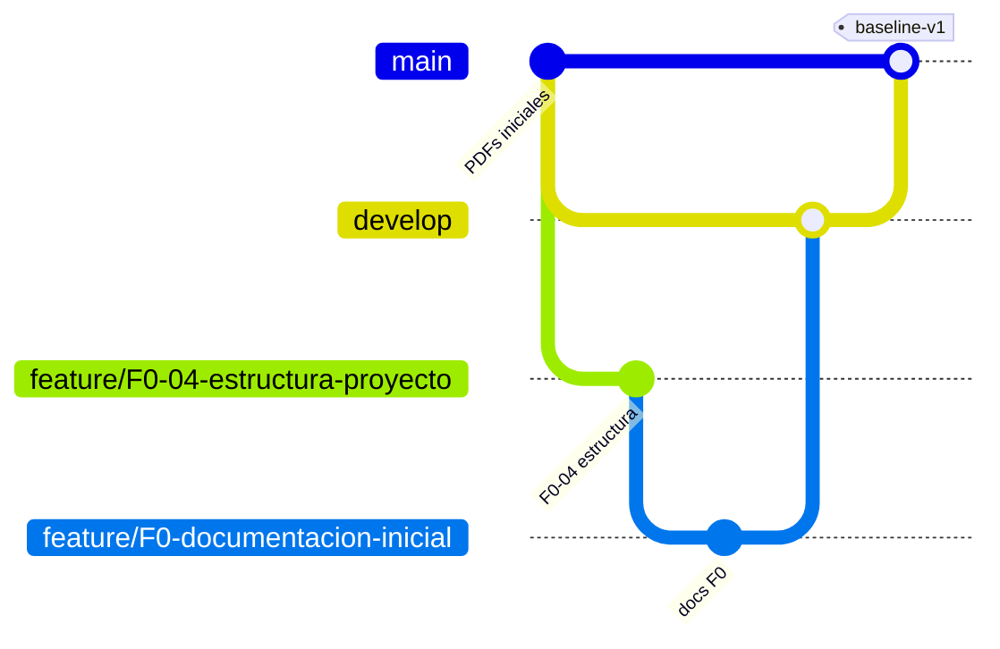

# Plan de configuración y DevOps

**Estado:** Vigente — CI en funcionamiento desde el Sprint 1; etiquetas pendientes hasta integrar los PR · **Unidad:** 8 · **Tarjetas:** CF-07, F0-06, S1-06 · **TP:** [Unidades 8 y 9](../08-trabajos-practicos/tp-unidades-8-9.md)

## 1. Elementos de configuración (EC)

| Tipo | Elemento | Ubicación | Control |
|---|---|---|---|
| Técnico | Código del backend y frontend | `backend/`, `frontend/` | Git, PR obligatorio |
| Técnico | Esquema y migraciones de base de datos | `backend/prisma/` | Git; migraciones nunca se editan una vez aplicadas |
| Técnico | Infraestructura local | `infra/docker/docker-compose.yml` | Git |
| Técnico | Pipeline CI | `.github/workflows/` | Git, revisión obligatoria |
| Técnico | Dependencias | `package.json` + `package-lock.json` | Git; actualización por PR |
| Técnico | Variables de entorno | `.env.example` (sí) / `.env` (no) | `.env` en `.gitignore` |
| Técnico | Scripts de respaldo | `scripts/backup/` | Git |
| Gestión | Requisitos, alcance, backlog | `docs/01`, `docs/04`, Trello | Línea base + control de cambios |
| Gestión | Registro de riesgos | `docs/04-gestion/riesgos.md` | Vivo, revisado por sprint |
| Gestión | Planes de calidad y configuración | `docs/05`, `docs/06` | Git |
| Gestión | Evidencias y bitácora de IA | `docs/07-evidencias`, `docs/bitacora-ia` | Git |

## 2. Líneas base

| Línea base | Contenido | Tag Git | Momento |
|---|---|---|---|
| Funcional | Requisitos + alcance + backlog aprobados | `baseline-v1` | Fin de Fase 0 (puerta G1) |
| Releases | Código + docs de cada release | `v0.1.0` (R1), `v0.2.0` (R2), `v0.3.0` (R3) | Fin de cada release (G4) |
| Producto | Versión estable de entrega | `v1.0.0` | Sprint 8 (G5) |

**Estado al 15/10/2026:** todavía no hay etiquetas creadas porque ningún PR se integró a `develop` (0 de 12). Las etiquetas `baseline-v1` y `v0.1.0`/`v0.2.0` se crean al integrar los PR en orden (decisión registrada en [monitoreo-metricas.md](../04-gestion/monitoreo-metricas.md#4-registro-de-decisiones-basadas-en-métricas)).

Versionado semántico `MAYOR.MENOR.PARCHE`. Un cambio en una línea base genera una nueva etiqueta (`baseline-v2`), nunca se mueve una etiqueta existente.

## 3. Estrategia de ramas



| Rama | Propósito | Reglas |
|---|---|---|
| `main` | Versiones estables y líneas base | Solo recibe merges desde `develop` en cierres de release; protegida; cada merge lleva tag. |
| `develop` | Integración continua del trabajo del sprint | Solo por PR con CI en verde y una revisión. |
| `feature/<código>-<descripción>` | Trabajo de una tarjeta de Trello | Nace de `develop`; vida corta; se borra después del merge. |
| `hotfix/<código>` | Corrección urgente sobre una versión | Nace de `main`; se integra a `main` y `develop`. |

## 4. Convenciones de trazabilidad

- **Commits:** `<CÓDIGO>: <descripción en presente>` — ej. `S3-01: agrega validación de carátula`. El código enlaza con la tarjeta de Trello.
- **Pull requests:** título con el código; descripción con *qué cambia*, *cómo se probó* y checklist de la DoD; enlace a la tarjeta.
- **Trello ↔ GitHub:** la tarjeta registra el enlace al PR; el PR registra el enlace a la tarjeta (Power-Up de GitHub opcional).
- **Cadena completa:** tarjeta → rama → commits → PR → ejecución CI → merge → tag de release.

## 5. Ambientes

| Ambiente | Dónde | Datos | Uso |
|---|---|---|---|
| Desarrollo | Equipo local + Docker | Seed ficticio | Trabajo diario |
| Pruebas | Base de pruebas local y servicio PostgreSQL en GitHub Actions | Generados por las pruebas | Suite automatizada |
| Demostración (piloto simulado) | Equipo local, build de producción, rama `main` | Datos de demostración (S8-02) | Sprint review, piloto y defensa |

Los ambientes se separan por variables de entorno (`NODE_ENV`, `DATABASE_URL`, `DATABASE_URL_TEST`); nunca comparten base de datos.

## 6. Integración y entrega continua (CI/CD)

**CI (Sprint 1, S1-06)** — implementado en [`.github/workflows/ci.yml`](../../.github/workflows/ci.yml). Se ejecuta en cada *push* a cualquier rama y en cada *pull request* a `develop` y `main`. Pasos reales: backend (`npm ci` → tipos con `prisma generate` → lint → pruebas con cobertura → `prisma migrate deploy` sobre PostgreSQL 18 de CI → seed → verificación de que la auditoría rechaza `DELETE` → build → auditoría de dependencias) y frontend (`npm ci` → tipos → lint → pruebas → build → auditoría de dependencias). Plan original:

```
checkout → instalar dependencias (npm ci) → lint → verificación de tipos
        → migraciones sobre PostgreSQL de prueba → pruebas + cobertura
        → npm audit (falla con vulnerabilidades altas) → build
```

**Entrega (CD) con aprobación institucional:**

- La publicación de una versión (merge a `main` + tag) requiere aprobación manual: regla de protección de rama y, opcionalmente, *environment* de GitHub con revisor obligatorio. Representa la aprobación del Gerente/Comité en las puertas G4 y G5.
- El workflow de release genera los artefactos de build y adjunta notas de versión desde `CHANGELOG.md`.

## 7. Despliegue gradual por dependencias

- El sistema maneja una lista de **dependencias habilitadas** (configuración en base de datos). En el piloto se habilita una dependencia; las demás se activan después de aprobar el piloto (hito H5).
- Cada habilitación se registra en auditoría.
- Orden propuesto: Mesa de Entradas → Asesoría Jurídica → Recursos Humanos.

## 8. Rollback

1. Volver a la etiqueta anterior estable (`git checkout vX.Y.Z` y nuevo build).
2. Si hubo migraciones incompatibles, restaurar la copia de seguridad tomada **antes** del despliegue (el procedimiento exige backup previo).
3. Deshabilitar la dependencia afectada si el problema es local a ella.
4. Registrar el incidente en riesgos (R11) y en evidencias.

## 9. Observabilidad

- Endpoint `/api/health` (estado de la API y de la conexión a la base).
- Logs estructurados (JSON) con nivel, fecha, ruta, código y duración; sin datos sensibles.
- Identificador de petición para correlacionar logs.
- Auditoría funcional consultable por el administrador.

## 10. Controles DevSecOps

| Control | Herramienta | Etapa |
|---|---|---|
| Secretos fuera del repositorio | `.gitignore`, `.env.example`, *secret scanning* de GitHub | Commit |
| Dependencias vulnerables | `scripts/ci/audit.mjs` (sobre `npm audit`) en CI: falla con vulnerabilidades altas o críticas en dependencias de producción; las de paquetes solo de desarrollo se publican como advertencia y se registran como deuda técnica (DT-05) | CI |
| Revisión obligatoria | Protección de ramas `main` y `develop` | PR |
| Análisis estático | ESLint + TypeScript estricto | CI |
| Pruebas de seguridad | PR-02, PR-09, PR-20, PR-25 | CI |
| Mínimo privilegio | Usuario de BD de la aplicación sin permisos sobre auditoría | Base de datos |
