# Capturas de la interfaz

## Inicio de sesión

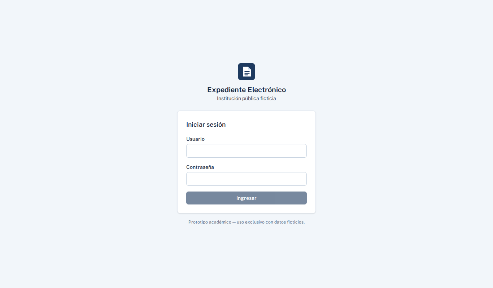

## Inicio con estadísticas (administrador)

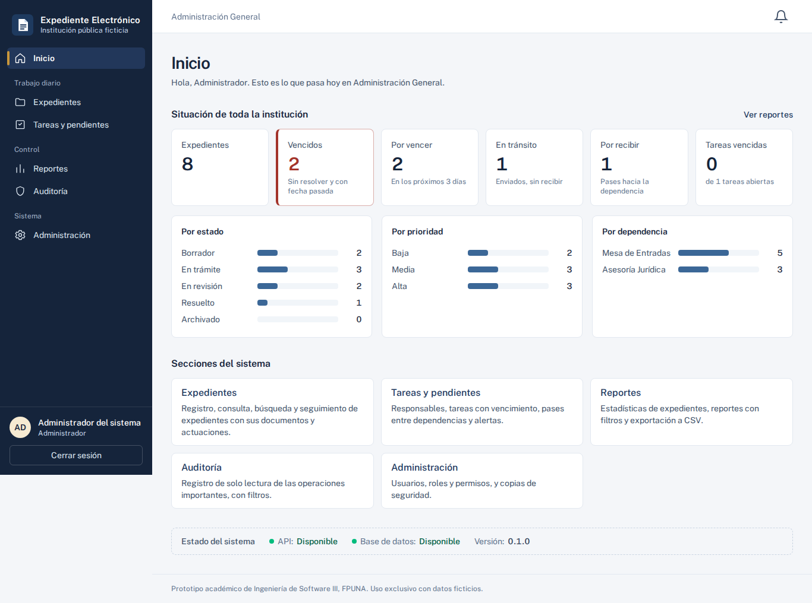

## Listado de expedientes

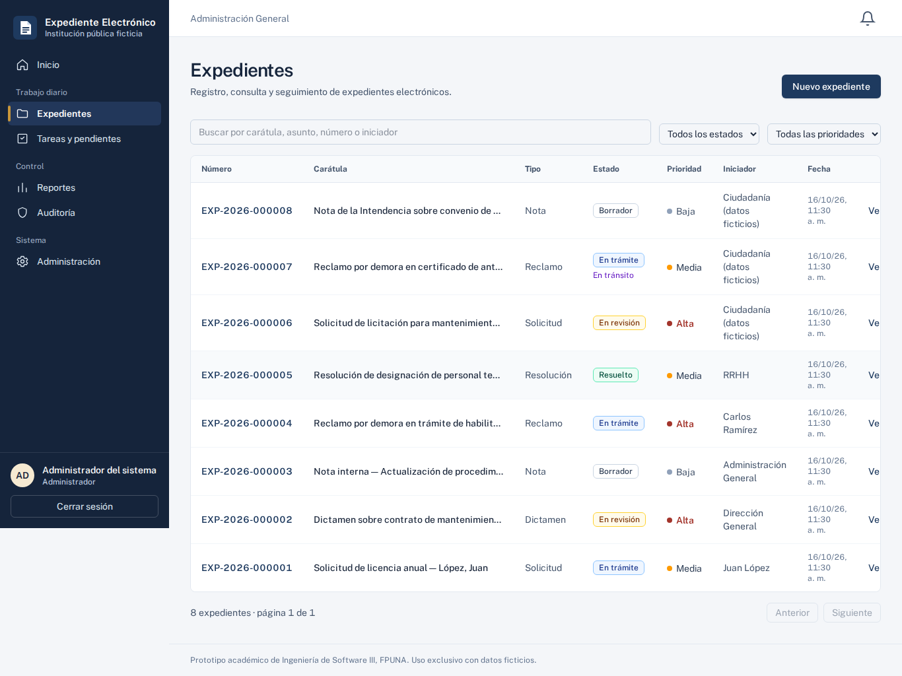

## Reportes

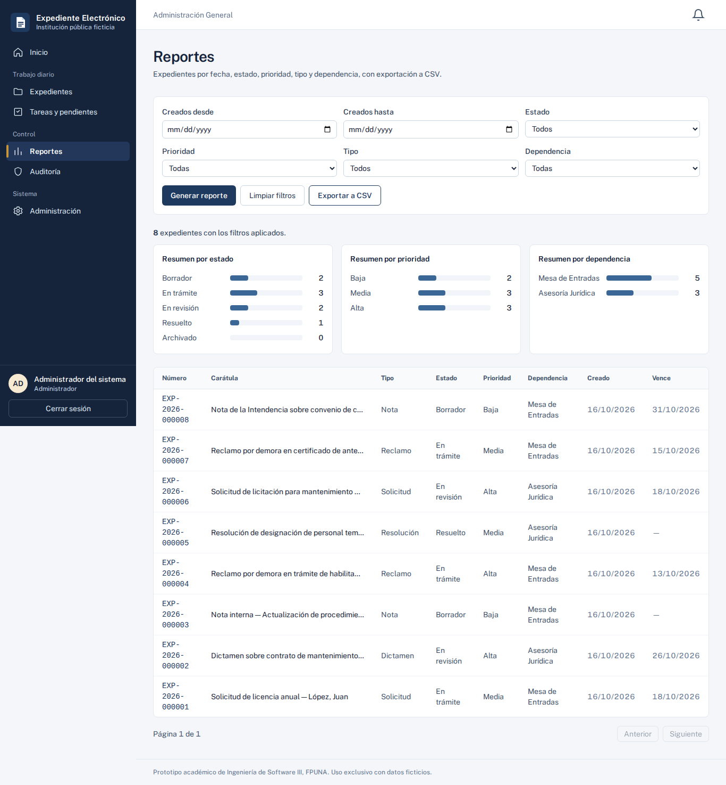

## Auditoría

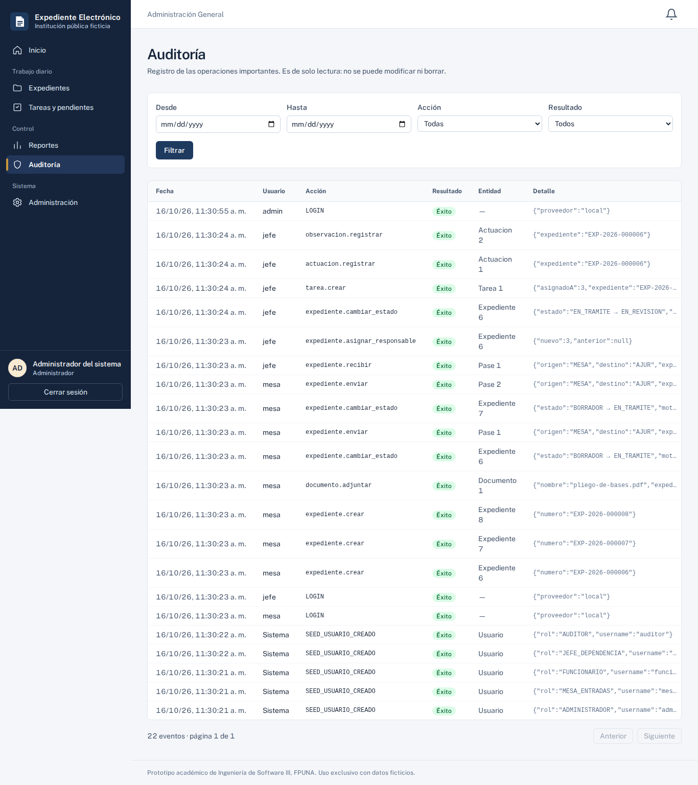

## Administración (usuarios y respaldos)

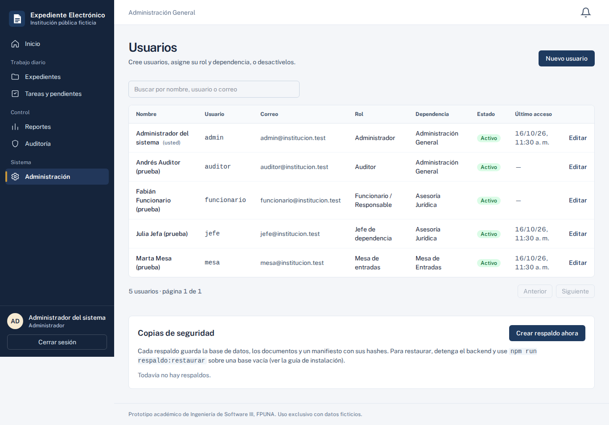

## Nuevo expediente

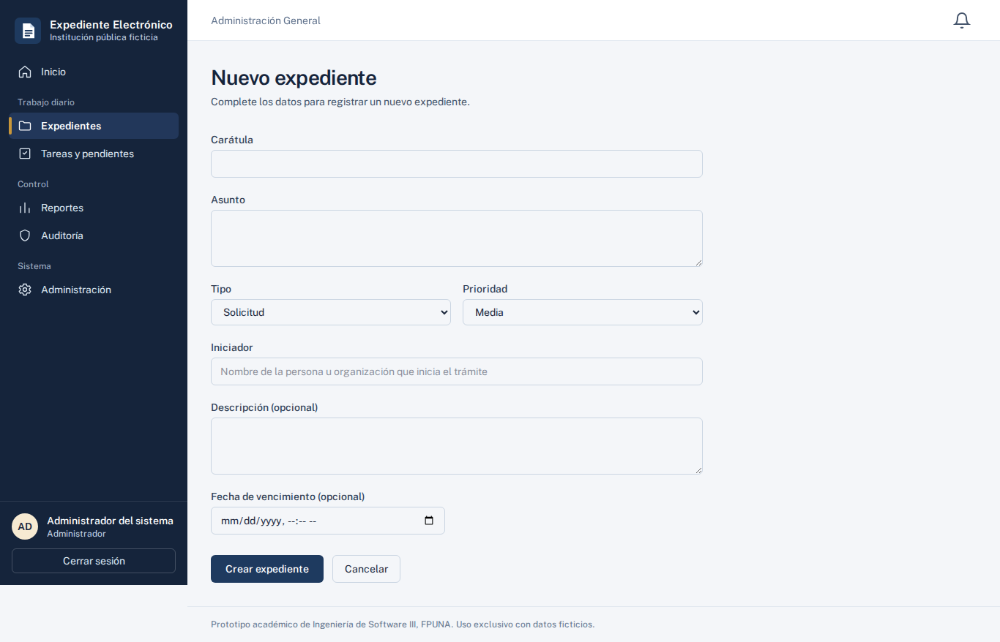

## Detalle de un expediente (jefe de Asesoría Jurídica)

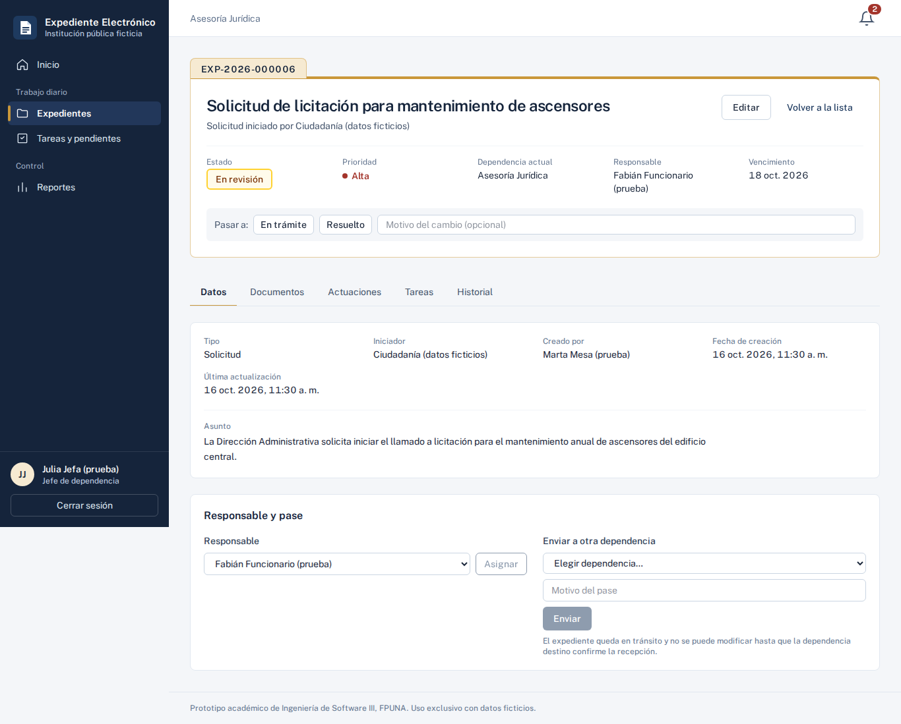

## Tareas y pendientes (jefe)

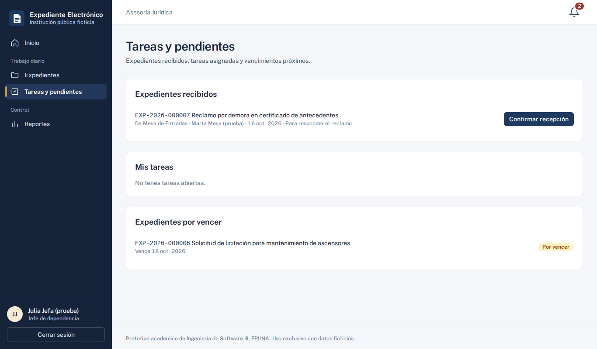

## Campana de notificaciones abierta

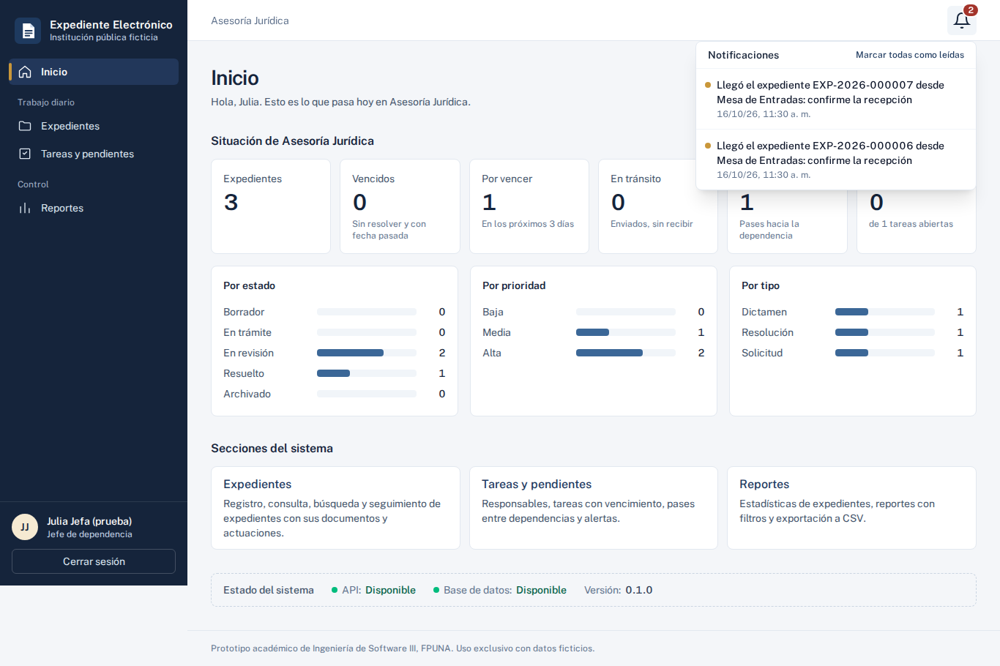

## Inicio de un funcionario (solo su dependencia)

## Inicio en el celular

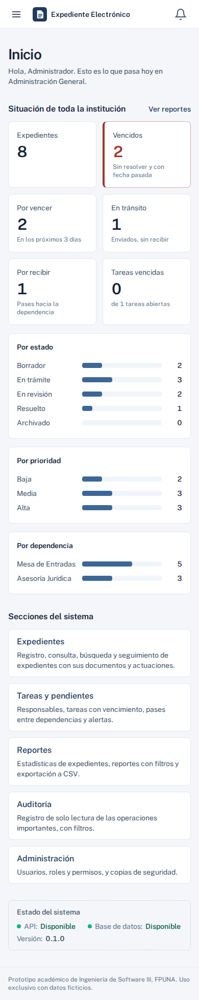

## Menú abierto en el celular

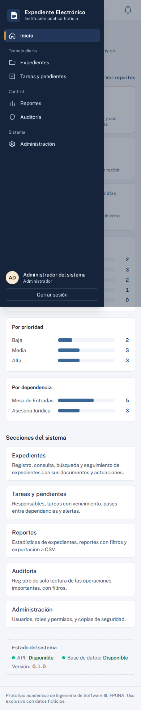
